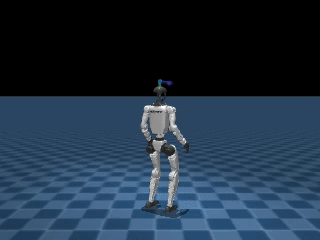
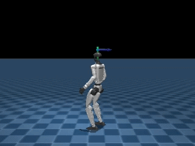
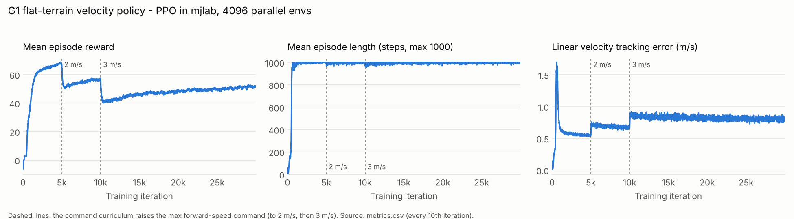
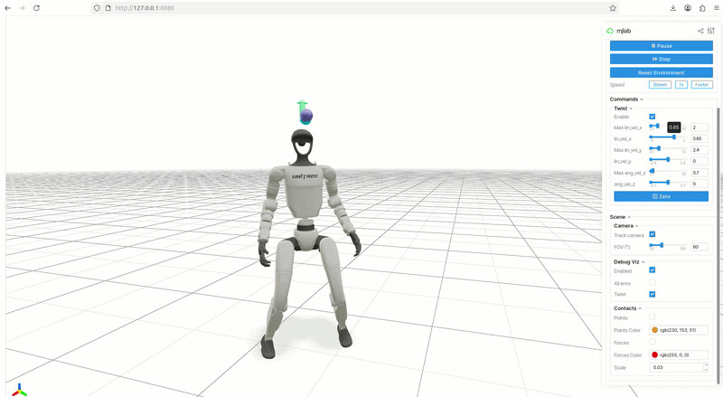
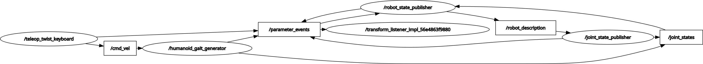

# Unitree G1 Humanoid Locomotion

[](https://github.com/velayudhana027/unitree-g1-locomotion/actions/workflows/ci.yml)


A simulation-first pipeline for the **Unitree G1** humanoid (29 DoF): from the robot description and RViz,
through physics simulation in MuJoCo, to a **reinforcement-learning walking policy** trained with
[mjlab](https://github.com/mujocolab/mjlab). The longer-term goal is human-like gait (motion imitation)
and object manipulation, validated virtually before any hardware deployment.

| Before training (iteration 0) | After training (iteration 29,999) |
| :---: | :---: |
|  |  |

## Results: flat-terrain velocity policy

PPO policy that tracks commanded forward, sideways and yaw velocities on flat ground.
All numbers come from the run's own logs ([`training/mjlab_velocity_flat`](training/mjlab_velocity_flat)).

| | |
| --- | --- |
| Task | `Mjlab-Velocity-Flat-Unitree-G1` (mjlab 1.2.0) |
| Algorithm | PPO (rsl_rl); actor and critic MLP 512-256-128, ELU, observation normalisation |
| Scale | 4,096 parallel environments, 30,000 iterations, 2.95 billion environment steps |
| Compute | 1x NVIDIA A100 40 GB on Google Colab, ~12.9 h, ~64k environment steps/s |
| Control | 50 Hz policy (5 ms physics step, decimation 4), 99-D observation, 29 joint targets |
| Commands (final curriculum) | forward -2 to 3 m/s, sideways ±1 m/s, yaw ±0.7 rad/s |
| Mean episode length, final | **992 / 1000 steps** (20 s episodes; falls are rare) |
| Mean episode reward, final | 51.0 |
| Velocity tracking error, final | 0.81 m/s linear (xy), 1.25 rad/s yaw |



The reward drops at 5k and 10k iterations are the command curriculum raising the maximum forward-speed
command (1 → 2 → 3 m/s), not instability: episode length stays at the cap throughout. Tracking error
also steps up with each wider speed range, which is the main thing left to improve.

Interactive playback in mjlab's web viewer, with velocity commands set from the browser:



## Roadmap

Everything is developed virtually first; hardware deployment depends on robot access.

| # | Stage | Status |
| --- | --- | --- |
| 1 | Digital twin from the official meshes and URDF | ✅ Done |
| 2 | RViz visualisation (TF, joint states, no physics) | ✅ Done |
| 3 | RViz kinematic locomotion (`cmd_vel` odometry + sinusoidal gait generator) | ✅ Done |
| 4 | MuJoCo model and test scene; PD posture hold | ✅ Done |
| 5 | MuJoCo locomotion: RL velocity policy (flat terrain) | ✅ Trained in mjlab |
| 5a | Rough-terrain fine-tuning from the flat checkpoint | 🔄 Started (cells in the Colab notebook) |
| 5b | Sim-to-sim: run the policy in plain MuJoCo, without mjlab | 🔄 In progress ([known issue](#known-issues)) |
| 6 | Camera-based pick and place | 📋 Planned, see [g1-tote-handling-twin](https://github.com/velayudhana027/g1-tote-handling-twin) |
| 7 | Human-like gait via motion imitation (BeyondMimic-style tracking) | 📋 Planned |
| 8 | Integration: A → B → C navigation with obstacle avoidance and manipulation at B | 📋 Planned |
| 9 | Data collection for sim-vs-real comparison | 📋 Planned |
| 10 | Hardware deployment and testing | ⏸ On hold (hardware access) |

Open tasks are tracked as [issues](https://github.com/velayudhana027/unitree-g1-locomotion/issues) under milestones.

## Repository structure

```
unitree_g1_description/   ROS 2 package: meshes, URDF, MuJoCo MJCF models and test scenes
unitree_g1_rviz/          ROS 2 package: RViz launch, cmd_vel odometry, sinusoidal gait generator
unitree_g1_mujoco/src/    MuJoCo scripts: viewer, PD stand, SB3 PPO standing, mjlab policy playback
training/                 Training run record: config, metrics, Colab notebook, plotting script
checkpoints/              Trained policies (mjlab .pt and ONNX export, SB3 standing model)
tests/                    Model and policy smoke tests, run by CI on every push
docs/media/               Figures and GIFs used in this README
```

## Quick start (MuJoCo)

```bash
git clone https://github.com/velayudhana027/unitree-g1-locomotion.git
cd unitree-g1-locomotion
python3 -m venv .venv && source .venv/bin/activate
pip install -r requirements.txt

python3 unitree_g1_mujoco/src/visualize_g1.py   # inspect the model in the MuJoCo viewer
python3 unitree_g1_mujoco/src/stand_g1.py       # PD posture-hold baseline
pytest tests                                    # model and policy checks
```

**Play the trained walking policy** (needs [mjlab](https://github.com/mujocolab/mjlab) installed; the policy was trained with mjlab 1.2.0, commit `18b1c8b`):

```bash
python3 unitree_g1_mujoco/src/mjlab_policy_load.py   # then open the printed URL (usually http://localhost:8080)
```

**Reproduce the training run** from a clone of mjlab (this is what [`train_colab.ipynb`](training/mjlab_velocity_flat/train_colab.ipynb) runs on an A100):

```bash
uv run train Mjlab-Velocity-Flat-Unitree-G1 --env.scene.num-envs 4096
```

**SB3 standing baseline** (CPU, single environment):

```bash
python3 unitree_g1_mujoco/src/train_g1_balance.py   # tensorboard --logdir ./logs/g1_tensorboard/
python3 unitree_g1_mujoco/src/test_g1_balance.py    # runs checkpoints/sb3_ppo_stand/g1_self_balance_final.zip
```

## Quick start (ROS 2 / RViz)

```bash
mkdir -p ~/g1_ws/src && cd ~/g1_ws/src
git clone https://github.com/velayudhana027/unitree-g1-locomotion.git
cd ~/g1_ws && rosdep install --from-paths src --ignore-src -y
colcon build && source install/setup.bash

ros2 launch unitree_g1_rviz display.launch.py                # URDF in RViz with joint sliders
ros2 run unitree_g1_rviz humanoid_gait_generator.py          # gait generator driven by /cmd_vel
ros2 run teleop_twist_keyboard teleop_twist_keyboard         # drive it from the keyboard
```



## Engineering notes

- **PD posture hold** (`stand_g1.py`): joint-space PD towards a crouched pose with a gain ramp. It holds a
  statue-like pose but has no active balance and collapses under small disturbances, so it serves as a baseline only.
- **SB3 PPO standing** (`train_g1_balance.py`): a single CPU environment with hand-shaped rewards (height,
  uprightness, anti-sway, action smoothing, energy). The learned policies balanced with unnatural motions, which
  is why training moved to GPU-parallel simulation.
- **mjlab velocity policy**: 4,096 parallel environments on one GPU made 3 billion steps practical in under a day
  and produced a stable walking policy on flat ground.

## Known issues

- `mjlab_policy_sim2sim.py` (running the policy in plain MuJoCo without mjlab) goes numerically unstable
  within the first second. The observation layout, default pose, action scale and per-joint PD gains need to be
  aligned with the values exported in the ONNX metadata (`checkpoints/mjlab_velocity_flat/policy.onnx`).
  The joint order is already verified to match (`tests/test_models.py`).

## Third-party components

- Robot meshes and base robot models: Unitree Robotics, [unitree_ros](https://github.com/unitreerobotics/unitree_ros),
  BSD 3-Clause ([`LICENSE.unitree`](unitree_g1_description/LICENSE.unitree)).
- Training framework: [mjlab](https://github.com/mujocolab/mjlab) (Apache 2.0), used as a dependency, not vendored.

## Author

**Velayudhan Aravindakshan**: humanoid robotics, reinforcement learning, simulation.
Code reviews, issues and suggestions are welcome.
